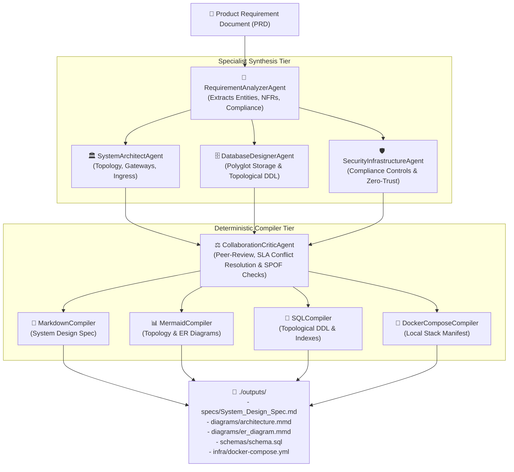

# 🏗️ Multi-Agent PRD-to-Architecture Generator

A deterministic, rule-verified multi-agent engine that automatically transforms Product Requirement Documents (**PRDs**) into production-ready system architecture specifications, interactive Mermaid diagrams, relational schemas, and infrastructure manifests.

---

## 🎯 Architecture & Multi-Agent Collaboration

Rather than relying on unconstrained LLM hallucinations, this engine employs an agentic pipeline where specialized agents reason over distinct architectural dimensions and a **Critic Agent** performs cross-domain verification and automated conflict resolution.



### Agent Roles & Responsibilities

| Agent | Responsibility | Key Reasoning Capabilities |
| :--- | :--- | :--- |
| **`RequirementAnalyzerAgent`** | PRD Parser & State Normalizer | Extracts functional entities, parent-child relations, field schemas, throughput (RPS), P99 latency budgets, availability SLAs, and compliance tags (`PII`, `PCI-DSS`, `HIPAA`, `SOC2`, `GDPR`). |
| **`SystemArchitectAgent`** | Topology & Boundary Decomposition | Evaluates `src/rules/topology_rules.yaml` thresholds. Decides between Modular Monolith, Service-Oriented, or Event-Driven Microservices. Configures CDN edge, API Gateways, Load Balancers, and WebSocket Gateways. |
| **`DatabaseDesignerAgent`** | Polyglot Storage & Relational DDL | Evaluates read/write access patterns. Assigns Primary DB (Single vs Multi-AZ), Redis Caching tier, and wide-column stores (ScyllaDB/Cassandra). Performs topological sort on entities to generate dependency-ordered DDL with foreign keys and indexes. |
| **`SecurityInfrastructureAgent`** | Compliance & Perimeter Hardening | Evaluates `src/rules/compliance_matrix.yaml`. Injects baseline controls (TLS 1.3, OAuth2 JWT, API rate limiting) and regulated frameworks (KMS encryption, PCI-DSS CDE isolation, HIPAA audit trails, DDoS shields). |
| **`CollaborationCriticAgent`** | Cross-Domain Peer-Reviewer & Fixer | Acts as the architectural reviewer. Validates latency budgets vs caching, verifies 4-nines availability infrastructure, flags PCI-DSS in shared monoliths, and auto-injects missing components (e.g., Redis, Kafka, Load Balancers). |

---

## 🚀 Quickstart

### Prerequisites
* Python 3.10+
* [uv](https://github.com/astral-sh/uv) (recommended) or standard `pip`

### 1. Installation
```bash
# Clone the repository and enter directory
cd prd-to-architecture-generator

# Install dependencies using uv
uv sync
```

### 2. Launch the Web Studio (ChatGPT-Style Interactive GUI)
Launch the modern, responsive ChatGPT-style conversational studio with live Mermaid vector diagram rendering, document attachments, conversation history, and interactive inspectors:

```bash
# Start the studio GUI (opens in your default browser at http://127.0.0.1:8080)
uv run python -m src.gui

# Or via the CLI --gui flag:
uv run python -m src.main --gui
```

#### What it looks like:
* **Conversational Chat Interface**: Type or paste any prompt into the floating message bar (e.g. *"Design an Uber clone with 35k RPS and GPS tracking"*).
* **Document Attachment (📎)**: Attach any `.txt`, `.md`, `.json` requirements file, or drag-and-drop directly into the chat window.
* **Agent Reasoning Trace**: Visual progress breakdown of all 5 specialized agents.
* **Interactive Architecture Response Cards**: Each message renders live Topology diagrams, ER data models, Critic audit logs, SQL DDL, and Docker Compose with one-click copy and download actions.
* **Sidebar History & Presets**: Keep track of previous architectural designs and click pre-built prompt templates.

### 3. Run via CLI with Flexible Input Options

The engine accepts **any document format**, arbitrary natural language requirements, interactive prompts, or standard PRDs:

```bash
# 1. Pass arbitrary text directly on command line:
uv run python -m src.main --text "Build an Uber clone. Riders request rides and drivers accept trips. Stripe handles payments. Realtime GPS tracking. We need 30k rps and four nines uptime." -s

# 2. Interactive Mode: Paste any document or type freely in terminal:
uv run python -m src.main --interactive

# 3. Pass any arbitrary file (.txt, .md, etc.) located anywhere:
uv run python -m src.main path/to/my_requirements.txt

# 4. Pipe requirements via stdin:
cat inputs/sample_fintech_prd.md | uv run python -m src.main -

# 5. Run standard sample files:
uv run python -m src.main inputs/sample_fintech_prd.md
uv run python -m src.main inputs/sample_healthcare_prd.md
uv run python -m src.main inputs/sample_ecommerce_flashsale_prd.md
uv run python -m src.main inputs/sample_iot_stream_prd.md
```

### CLI Options
```text
usage: python -m src.main [-h] [-i INPUT_FILE_FLAG] [-t TEXT] [-I] [-o OUTPUT_DIR] [-s] [--gui] [--port PORT] [input_path]

positional arguments:
  input_path            Path to an input PRD file (.md, .txt, etc.), or '-' to read from standard input

options:
  -h, --help            Show this help message and exit
  -i, --input           Alternative flag to specify input PRD document path
  -t, --text TEXT       Directly pass arbitrary requirements or PRD text via command line
  -I, --interactive     Interactive mode: prompt to type or paste requirements in terminal
  -o, --output-dir      Directory to save generated architectural artifacts (default: outputs)
  -s, --summary-only    Print only the executive summary and artifact locations instead of full spec
  --gui                 Launch the interactive Multi-Agent Architecture Studio Web GUI
  --port PORT           Port number for the GUI web server (default: 8080)
```

---

## 📦 Generated Output Artifacts

Every run outputs production-grade artifacts in `./outputs/`:

* **`outputs/specs/System_Design_Spec.md`**  
  Comprehensive, audit-ready System Design Specification with NFRs, Critic review findings, service boundaries, storage matrices, and security controls.
* **`outputs/diagrams/architecture.mmd`**  
  Mermaid flowchart illustrating Ingress, Compute, Messaging (Kafka), and Polyglot Storage tiers.
* **`outputs/diagrams/er_diagram.mmd`**  
  Mermaid `erDiagram` visualizing entity relationships, fields, and cardinality.
* **`outputs/schemas/schema.sql`**  
  PostgreSQL DDL schema with primary keys, topologically sorted foreign keys, and lookup indexes.
* **`outputs/infra/docker-compose.yml`**  
  Working Docker Compose stack matching the generated architecture (Postgres, Redis, Kafka, ScyllaDB, etc.).

---

## 🧪 Running the Test Suite

The project includes an end-to-end test suite verifying agent behaviors, edge cases, topological sorting, and compilers:

```bash
uv run pytest -v
```

---

## 🛠️ Project Structure

```text
prd-to-architecture-generator/
├── inputs/                                   # Sample PRD Documents
│   ├── sample_fintech_prd.md                 # 12k RPS, PCI-DSS, WebSockets
│   ├── sample_healthcare_prd.md              # HIPAA, Telehealth, EHR
│   ├── sample_ecommerce_flashsale_prd.md     # 28k RPS, Inventory Locks, ScyllaDB
│   ├── sample_iot_stream_prd.md              # 65k RPS, Sensor Streaming
│   └── sample_monolith_compliance_conflict_prd.md # Critic Trigger Demo
├── outputs/                                  # Auto-Generated Artifacts
│   ├── diagrams/                             # Mermaid Architecture & ER Diagrams
│   ├── infra/                                # Generated docker-compose.yml
│   ├── schemas/                              # Generated schema.sql DDL
│   └── specs/                                # System_Design_Spec.md
├── src/
│   ├── agents/                               # Specialist & Critic Agents
│   │   ├── analyzer_agent.py                 # PRD Parser & Entity Extractor
│   │   ├── architect_agent.py                # Topology & Scalability Agent
│   │   ├── base_agent.py                     # Agent Abstract Base Class
│   │   ├── critic_agent.py                   # Peer Review & Conflict Resolver
│   │   ├── database_agent.py                 # Storage Selection & Schema Designer
│   │   └── security_agent.py                 # Compliance & Perimeter Hardener
│   ├── compilers/                            # Deterministic Code Compilers
│   │   ├── docker_compose_compiler.py        # Generates docker-compose.yml
│   │   ├── markdown_compiler.py              # Jinja2 Spec Renderer
│   │   ├── mermaid_compiler.py               # Generates Mermaid .mmd
│   │   └── sql_compiler.py                   # Generates PostgreSQL .sql DDL
│   ├── orchestrator/                         # Pipeline Coordinator
│   │   └── pipeline.py
│   ├── rules/                                # Configurable Rule Matrices
│   │   ├── compliance_matrix.yaml            # Standards & Security Controls
│   │   └── topology_rules.yaml               # Scale Thresholds & Caching Rules
│   ├── state/                                # Pydantic State Schemas
│   │   ├── arch_state.py                     # Shared Architecture Output
│   │   └── prd_schema.py                     # Extracted PRD Model
│   ├── templates/                            # Jinja2 Specification Templates
│   │   └── system_design_spec.md.j2
│   └── main.py                               # CLI Entrypoint
├── tests/                                    # Pytest Unit & Integration Tests
│   ├── test_agents.py
│   ├── test_analyzer.py
│   ├── test_compilers.py
│   ├── test_critic.py
│   └── test_pipeline.py
└── pyproject.toml                            # Project Dependencies & Config
```
